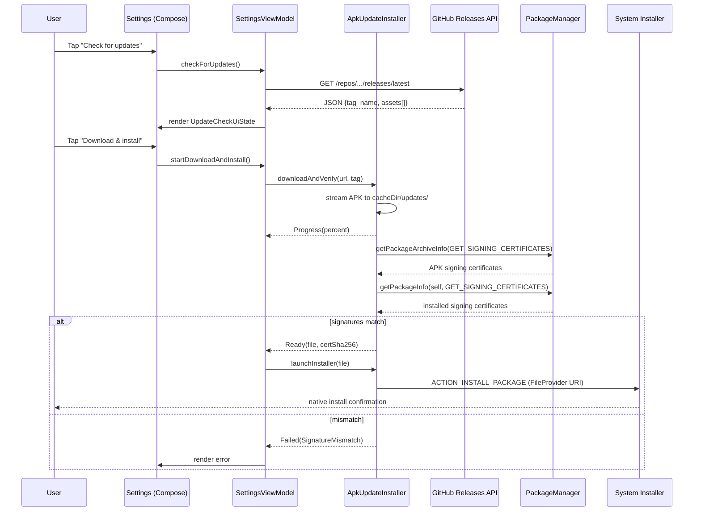

# DriveReply — Architecture & Developer Documentation

This document provides a comprehensive technical overview of the **DriveReply** architecture, detailing the background execution lifecycles, database schemas, permission models, and custom visual rendering engines.

---

## 1. System Architecture Diagram

Below is the complete background pipeline, showing the interaction between the Android OS triggers, the foreground monitoring service, and the dynamic notification listener engine:

```mermaid
sequenceDiagram
    autonumber
    participant Sensors as Android OS (GPS / Bluetooth / Transitions)
    participant Recv as Receivers (ActivityTransition / Bluetooth)
    participant Service as DriveReplyService (Foreground)
    participant listener as WhatsAppNotificationListener
    participant DB as AppDatabase (Room)

    Note over Sensors, Recv: Trigger Source 1: Activity Recognition IN_VEHICLE
    Sensors->>Recv: Broadcast: ENTER IN_VEHICLE
    Recv->>Service: Set DrivingState = True, Clear Session Contacts

    Note over Sensors, Service: Trigger Source 2: GPS Speed > Threshold
    Sensors->>Service: LocationCallback: Speed > Threshold (e.g. 20 km/h)
    Service->>Service: Set DrivingState = True, Clear Session Contacts

    Note over Sensors, Recv: Trigger Source 3: Bluetooth Car Connection
    Sensors->>Recv: Broadcast: BluetoothDevice ACL_CONNECTED
    Recv->>Service: If ServiceEnabled & Matches paired MAC -> Start Service & Set DrivingState = True

    Service->>Service: Update Persistent Notification ("Driving detected...")
    
    rect rgb(30, 40, 50)
        Note right of listener: Notification Received (Any Supported App)
        listener->>listener: Intercept: WhatsApp, WhatsApp Business, Telegram, Telegram X, Signal, Messenger, SMS apps
        listener->>listener: Verify NOT self-message (EXTRA_SELF_DISPLAY_NAME / MessagingStyle senderPerson)
        listener->>listener: Verify NOT group chat (unless override setting active)
        listener->>listener: Check if Conversation already replied in session or within cooldown window
        listener->>DB: Query custom template rules for Sender (case-insensitive)
        DB-->>listener: Returns matched rules list
        listener->>listener: Match rules against Current Day & Time bounds (incl. overnight windows)
        alt Rule Matched with Existing Template
            listener->>DB: Fetch rule's Template
        else No Rule Matched
            listener->>DB: Fetch active global Template
        end
        DB-->>listener: Returns target Template body
        listener->>listener: Locate highest-scored RemoteInput Reply Action
        listener->>Service: Mark conversation replied (atomic deduplication + cooldown)
        listener->>listener: Send Inline Reply via RemoteInput (SOURCE_FREE_FORM_INPUT)
        listener->>DB: Log sent reply & prune expired logs per retention policy
    end

    Sensors->>Recv: Broadcast: EXIT IN_VEHICLE
    Recv->>Service: Schedule 2-Minute Activity Exit Debounce Timer
    alt Debounce timer expires without vehicular ENTER re-trigger
        Service->>Service: Clear ACTIVITY_RECOGNITION trigger & re-evaluate DrivingState
        Service->>Service: Update Notification ("Driving stopped — auto-reply paused")
    else Vehicular ENTER re-trigger occurs before 2 minutes
        Service->>Service: Cancel Debounce Timer, remain Driving
    end
```



---

## 2. Core Service Components & Mechanics

### A. Foreground Service (`DriveReplyService.kt`)
To survive aggressive system memory reclaim, the monitoring is bound to a foreground service utilizing `specialUse|location` foreground service types (`FOREGROUND_SERVICE_TYPE_SPECIAL_USE` by default, adding `FOREGROUND_SERVICE_TYPE_LOCATION` when fine location permission is granted and GPS speed tracking is active).
- **Foreground States**: Exposes a global companion `StateFlow<Boolean>` representing active driving state, backed by active trigger-source tracking (`ACTIVITY_RECOGNITION`, `BLUETOOTH`, `GPS_SPEED`, `MANUAL_SIMULATION`), plus a synchronized `ConcurrentHashMap` set and per-conversation cooldown map used for deduplication.
- **Manual Simulation Override**: Uses explicit trigger source tracking (`MANUAL_SIMULATION` vs automatic triggers) to prevent automatic stop triggers from disabling manual simulation mode, and only clears session deduplication state when transitioning from not-driving (`false`) to driving (`true`).
- **GPS Speed Polling & Exit Debounce**: Employs `FusedLocationProviderClient` with interval updates. Calculates real-time speed and transitions the app into driving mode if speed exceeds the user-configured threshold, using a 2-minute debounce before clearing driving state when speed drops or `IN_VEHICLE` exits.

### B. Bluetooth Pairing Trigger (`BluetoothReceiver.kt`)
Listens to `BluetoothDevice.ACTION_ACL_CONNECTED` and `BluetoothDevice.ACTION_ACL_DISCONNECTED`.
- **Match Mechanism**: Verifies `isServiceEnabled` is active in `PreferencesManager`, then compares the connecting MAC address against the user's selected "Car Bluetooth" devices `StringSet`.
- **Trigger Actions**: Starts `DriveReplyService` (with safe background start exception handling on Android 12+) and activates the `BLUETOOTH` driving trigger upon match, and clears the `BLUETOOTH` trigger state upon disconnection while leaving the monitoring service active if other triggers remain.

### C. Generalized Notification Listener (`WhatsAppNotificationListener.kt`)
Extends `NotificationListenerService` to capture status bar notification updates across multiple communication platforms.
- **Supported Packages**:
  - WhatsApp (`com.whatsapp`) & WhatsApp Business (`com.whatsapp.w4b`)
  - Telegram (`org.telegram.messenger`) & Telegram X (`org.thunderdog.challegram`)
  - Signal (`org.thoughtcrime.securesms`)
  - Facebook Messenger (`com.facebook.orca`)
  - Google Messages (`com.google.android.apps.messaging`)
  - Samsung Messages (`com.samsung.android.messaging`)
  - AOSP Messages (`com.android.messaging`)
- **Platform-Agnostic Extraction**: Scans the notification `actions` and `WearableExtender(notification).actions` arrays, scores reply candidates by `SEMANTIC_ACTION_REPLY`, `allowGeneratedReplies`, and localized reply titles, and executes replies silently via:
  ```kotlin
  val fillInIntent = Intent().apply {
      val replyBundle = Bundle().apply {
          remoteInputs.forEach { remoteInput ->
              putCharSequence(remoteInput.resultKey, template.body)
          }
      }
      RemoteInput.addResultsToIntent(replyAction.remoteInputs, this, replyBundle)
      RemoteInput.setResultsSource(this, RemoteInput.SOURCE_FREE_FORM_INPUT)
  }
  replyAction.actionIntent.send(this@WhatsAppNotificationListener, 0, fillInIntent)
  ```
- **Conversation-Level Deduplication & Cooldown**: Dedupes by conversation identity (`package + tag`, falling back to conversation title or notification ID + contact key) and enforces a cross-session cooldown window to prevent rapid session-flap spam. Marks conversations atomically before sending and rolls back via `unmarkConversationReplied` if `PendingIntent.send` throws.
- **Self-Message Guard**: Ignores incoming notifications resolved as the account’s own display name (`EXTRA_SELF_DISPLAY_NAME`) or where the latest `MessagingStyle.Message` has a null or self-matching `senderPerson`.
- **Listener Health Signals**: Exposes listener connectivity state and logs lifecycle transitions (`created`, `connected`, `disconnected`, `destroyed`) for diagnostics.

### D. Dynamic Template Rule Matching
When a message is received, `WhatsAppNotificationListener` consults `TemplateRuleDao` with the sender's contact name (case-insensitive):
1. Fetches all rules matching `contactName` (ignoring case/whitespace) or general catch-all rules (`contactName IS NULL`).
2. Checks day-of-week active rules (`1` = Monday to `7` = Sunday) via `TemplateRule.matches(...)`.
3. Evaluates time window bounds (compares local milliseconds-since-midnight against `startTime` and `endTime` windows, supporting both same-day and overnight windows where `startTime > endTime`).
4. Prioritizes specific contact rules over catch-all schedule rules, selecting the first matching rule whose referenced `MessageTemplate` exists.
5. If no rules match, falls back to the active global template.

---

## 3. Database Architecture (Room DB — Schema v4)

### Entity: `message_templates`
Stores reply message presets defined by the user. Prepopulated synchronously via SQLite `onCreate` with default `"Driving"` and `"Busy"` templates.

| Column | Type | Constraints | Description |
| :--- | :--- | :--- | :--- |
| `id` | `TEXT` | `PRIMARY KEY` | Unique UUID string |
| `name` | `TEXT` | `NOT NULL` | Template name (e.g., "Driving") |
| `body` | `TEXT` | `NOT NULL` | Template message content |
| `isActive` | `INTEGER` | `NOT NULL` | Active toggle (0 for false, 1 for true) |
| `createdAt` | `INTEGER` | `NOT NULL` | Unix timestamp of creation |

### Entity: `reply_log`
Chronological history of replies executed by the application (indexed on `timestamp`, pruned automatically per `logRetentionDays` and capped at 500 rows on UI queries).

| Column | Type | Constraints | Description |
| :--- | :--- | :--- | :--- |
| `id` | `TEXT` | `PRIMARY KEY` | Unique UUID string |
| `contactName` | `TEXT` | `NOT NULL` | Contact name/number of recipient |
| `templateName` | `TEXT` | `NOT NULL` | Name of template used for reply |
| `messageSent` | `TEXT` | `NOT NULL` | Message body delivered to the recipient |
| `packageName` | `TEXT` | `NOT NULL` | Target application package name (e.g., `com.whatsapp`) |
| `timestamp` | `INTEGER` | `NOT NULL, INDEXED` | Unix timestamp of execution |

### Entity: `template_rules`
Defines schedules and contact-specific routing mappings (indexed on `templateId` and `contactName`).

| Column | Type | Constraints | Description |
| :--- | :--- | :--- | :--- |
| `id` | `TEXT` | `PRIMARY KEY` | Unique UUID string |
| `templateId` | `TEXT` | `NOT NULL, INDEXED` | Foreign key matching `message_templates.id` |
| `contactName` | `TEXT` | `NULLABLE, INDEXED` | Specific contact match (null acts as catch-all) |
| `daysOfWeek` | `TEXT` | `NULLABLE` | Comma-separated active days (e.g., `"1,2,3,4,5"`) |
| `startTime` | `INTEGER` | `NULLABLE` | Start time window in milliseconds since midnight |
| `endTime` | `INTEGER` | `NULLABLE` | End time window in milliseconds since midnight |

---

## 4. Safety Analytics Custom Canvas Rendering

The Analytics dashboard employs native Jetpack Compose `Canvas` drawing to visualize distracted driving metrics cleanly and efficiently:

### A. Cubic Spline Path Calculation
Rather than drawing rigid straight lines between daily reply data points, the spline chart computes curved cubic Bezier coordinates.
- For each sequential coordinate $P_{idx}(x, y)$ and $P_{idx-1}(x,y)$, it places two symmetric control points:
  $$C_1 = \left( \frac{x_{idx} + x_{idx-1}}{2}, y_{idx-1} \right)$$
  $$C_2 = \left( \frac{x_{idx} + x_{idx-1}}{2}, y_{idx} \right)$$
- The path is drawn smoothly using:
  ```kotlin
  path.cubicTo(c1.x, c1.y, c2.x, c2.y, current.x, current.y)
  ```
- Area under the spline is filled using a fading vertical `Brush.verticalGradient` bounding from primary accent to transparent on the Y axis.

### B. Segmented Donut Arc Calculation
App distributions are rendered as a custom segmented ring using standard polar geometry coordinates.
- Total replies are summed to calculate angular ratios:
  $$\theta_{sweep} = \left( \frac{\text{Count}_{app}}{\text{Total}} \right) \times 360^\circ$$
- Drawn sequentially with a custom `Stroke(width = strokePx, cap = StrokeCap.Round)` styling. The rounded cap guarantees an extremely smooth, premium, modern dashboard visual.

---

## 5. Configurations & Resiliency

### A. Auto-Listener Rebinding
In rare cases, the Android system may disconnect the custom `NotificationListenerService` due to memory pressure or system-level configuration changes. To guarantee maximum reliability, `WhatsAppNotificationListener` overrides `onListenerDisconnected()`:
```kotlin
override fun onListenerDisconnected() {
    super.onListenerDisconnected()
    requestRebind(ComponentName(this, WhatsAppNotificationListener::class.java))
}
```
This forces the OS to re-bind the listener immediately upon memory recovery.

DriveReply also includes additional recovery safeguards:
- Home screen warns when notification access is granted but listener is not connected.
- Home screen exposes a manual **Rebind Listener** action.
- ViewModel can trigger rebind recovery and logs each attempt for traceability.

### B. In-App Debug Logging
DriveReply includes an internal opt-in debug log ring buffer (`DebugEventLogger`, bounded at 500 entries) to simplify support and field diagnostics while protecting user privacy:
- Disabled by default (`debugLogsEnabled = false`); disabling automatically purges any buffered entries in memory.
- Runtime events are appended with timestamps (service state changes, listener events, reply decisions) with PII redaction for contact identifiers.
- Settings → Debugging exposes:
  - `Enable Debug Logs` toggle
  - log viewer and quick diagnostics snapshot generator
  - `Copy Logs`, `Copy Snapshot`, and `Clear Logs` actions
- This avoids mandatory ADB/logcat usage for most troubleshooting.

### C. GitHub Release Versioning & Update Checks
DriveReply aligns application metadata and release tags:
- CI generates release tags as `v2.0.<run_number>`.
- APK metadata is set at build time with:
  - `versionName = 2.0.<run_number>`
  - `versionCode = <run_number>`
- Settings → Updates & About provides an in-app update flow that queries the latest signed release from GitHub, streams the APK to a temporary `.apk.part` file in `cacheDir/updates/` (enforcing HTTPS, trusted GitHub hosts, and a 100 MB size cap), verifies package name, `longVersionCode`, and signing certificate match against the installed app, atomically renames to `.apk`, and hands off to the system package installer.

#### Update Pipeline


